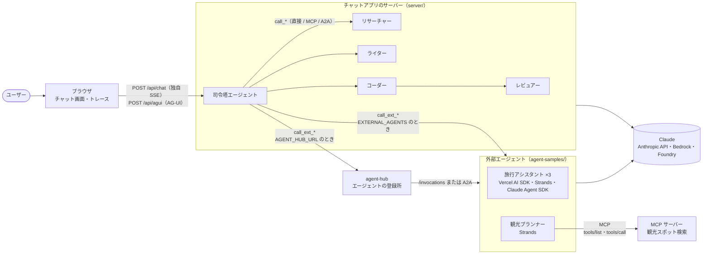
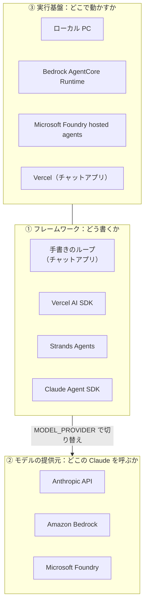
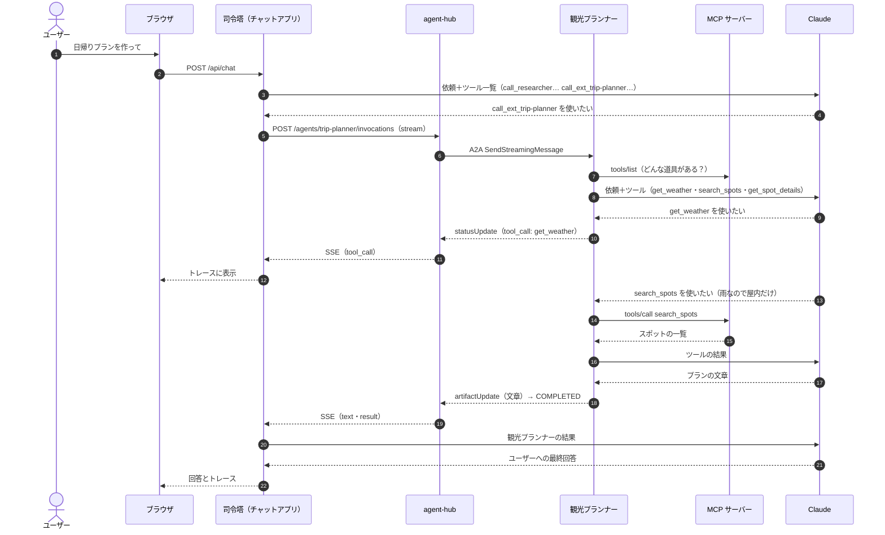
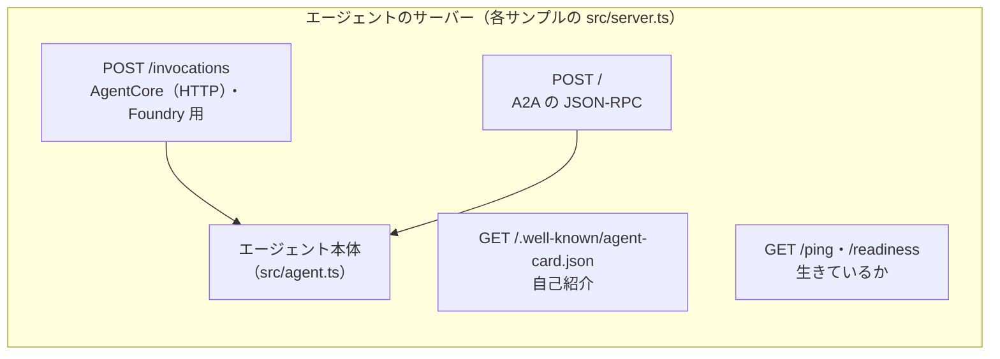
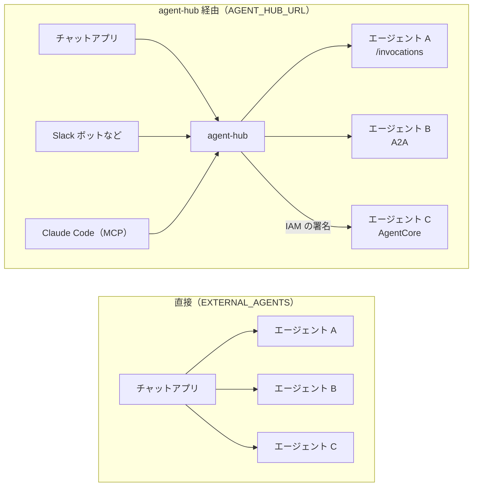
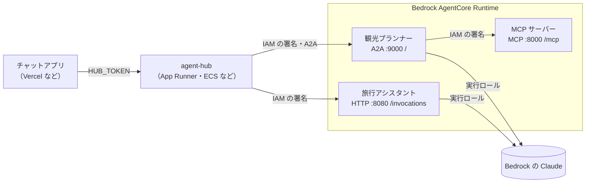
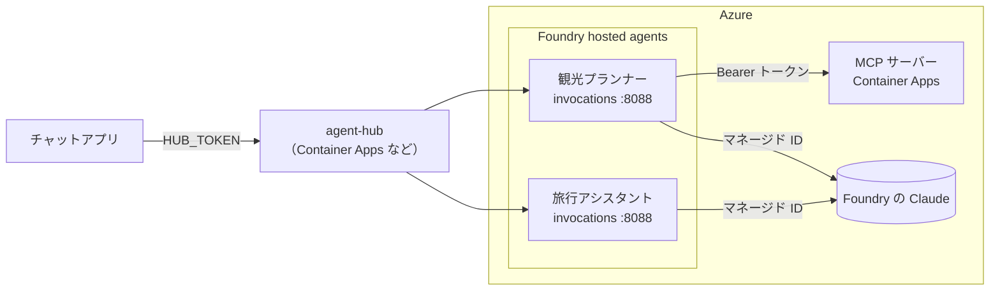

# 全体構成ガイド

このリポジトリにあるもの全部の関係を、図でまとめた資料です。
細かい使い方は [README](../README.md)（チャットアプリ）と [agent-samples/README.md](../agent-samples/README.md)（エージェントのサンプル集）にあります。

## 目次

1. [全体像](#1-全体像)
2. [3 つの層で考える](#2-3-つの層で考える)
3. [登場するもの一覧](#3-登場するもの一覧)
4. [1 回のチャットで何が起きるか](#4-1-回のチャットで何が起きるか)
5. [3 つの通信方式: /invocations・A2A・MCP](#5-3-つの通信方式-invocationsa2amcp)
6. [自己紹介（Agent Card）の取り方](#6-自己紹介agent-cardの取り方)
7. [つなぎ方: 直接か、agent-hub 経由か](#7-つなぎ方-直接かagent-hub-経由か)
8. [クラウドに置いたときの形](#8-クラウドに置いたときの形)
9. [エージェントを増やすときの手順](#9-エージェントを増やすときの手順)
10. [ファイル早見表](#10-ファイル早見表)

---

## 1. 全体像

- **チャットアプリ**の中には 5 つのエージェントがいて、司令塔がユーザーと話します。簡単な質問には自分で答え、必要なときだけほかのエージェントをツールとして呼びます。
- **外部エージェント**は別のサーバーで動くエージェントです。司令塔からは `call_ext_<id>` というツールに見えます。
- **agent-hub** は、外部エージェントの一覧と呼び出しの中継を引き受ける普通の Web サービスです（エージェントではありません）。
- **MCP サーバー**は、エージェントに道具（ツール）を貸す役です。観光プランナーは観光スポットの情報をここから借ります。

## 2. 3 つの層で考える

エージェントの話は、次の 3 つを分けて考えると整理できます。**それぞれ別々に選べます。**

| 層 | 決めること | このリポジトリでの切り替え方 |
|---|---|---|
| ① フレームワーク | ループの回し方、ツールの書き方 | フォルダを選ぶ |
| ② モデルの提供元 | 請求先、認証、使えるリージョン | 環境変数 `MODEL_PROVIDER` |
| ③ 実行基盤 | サーバー管理、スケール、権限 | 同じコンテナを AgentCore / Foundry に置く |

## 3. 登場するもの一覧

| もの | 種類 | 受ける通信 | 使う通信 | 場所 |
|---|---|---|---|---|
| チャット画面 | 画面 | — | `/api/chat`（SSE）、`/api/agui`（AG-UI） | `web/` |
| 司令塔ほか 4 体 | エージェント（手書き） | 内部の関数・MCP・A2A | Claude、外部エージェント | `server/agents/` |
| 旅行アシスタント ×3 | エージェント（SDK） | `/invocations`、A2A | Claude | `agent-samples/{vercel-ai-sdk,strands,claude-agent-sdk}/` |
| 観光プランナー | エージェント（SDK） | `/invocations`、A2A | Claude、MCP | `agent-samples/trip-planner/` |
| MCP サーバー | 道具箱 | MCP（Streamable HTTP） | — | `agent-samples/mcp-server/` |
| agent-hub | 登録所（Web サービス） | REST、MCP | `/invocations`、A2A | `agent-samples/agent-hub/` |

## 4. 1 回のチャットで何が起きるか

「東京で雨でも楽しめる日帰りプランを作って」と送った場合（チャットアプリが agent-hub 経由、観光プランナーは A2A で登録されている例）。

ポイント:

- **ツールを使うかどうか、どれを使うかは毎回 Claude が決めます。** 司令塔も観光プランナーも、決まった手順を書いているわけではありません。
- 司令塔から見えるのは、観光プランナーが **教えてくれた範囲（ツール呼び出しと文章）だけ** です。相手の中で何回 Claude を呼んだかなどは見えません。
- 観光プランナーは会話の履歴を知りません。司令塔が依頼文（task）に前提を書いて渡します。

## 5. 3 つの通信方式: /invocations・A2A・MCP

| | `/invocations` | A2A | MCP |
|---|---|---|---|
| 何をつなぐか | 実行基盤 ↔ エージェント | エージェント ↔ エージェント | エージェント ↔ 道具 |
| 決めているのは | AgentCore / Foundry（それぞれ独自） | 標準（Agent2Agent Protocol） | 標準（Model Context Protocol） |
| 頼み方 | `{"prompt": "..."}` を POST | メッセージを送ると「タスク」が始まる | ツール名と、決まった形の引数を送る |
| 返ってくるもの | 中身は自由（このリポジトリでは SSE で途中経過） | タスクの状態の変化と成果物（Artifact） | ツールの結果 |
| 自己紹介 | 決まりなし（このリポジトリでは `action: describe`） | Agent Card | `tools/list` |
| 相手は | 考えて動く（エージェント） | 考えて動く（エージェント） | 言われたとおりに動く（関数） |
| このリポジトリでの例 | AgentCore / Foundry に置くエージェントの入り口 | 各エージェントの `POST /`、ハブ → 観光プランナー | 観光プランナー → MCP サーバー、ハブの `/mcp` |

覚え方: **MCP は「道具を貸す」、A2A は「仕事を頼む」、`/invocations` は「実行基盤がコンテナに渡す口」** です。

各エージェントは 1 つのサーバーで、`/invocations` と A2A の両方に答えます。

## 6. 自己紹介（Agent Card）の取り方

呼ぶ側が「誰が・何をできるか」を知るための自己紹介は、置き場所によって取り方が違います。中身はどれも同じ A2A の Agent Card です。

| 置き場所 | 取り方 | 誰が使っているか |
|---|---|---|
| ローカル・パスがそのまま届く場所 | `GET /.well-known/agent-card.json` | チャットアプリ（`EXTERNAL_AGENTS`）、A2A クライアント |
| AgentCore（HTTP 方式）・Foundry | `POST /invocations {"action":"describe"}`（このリポジトリ独自の約束） | agent-hub、`agentcore-invoke.sh --describe` |
| AgentCore（A2A 方式） | AWS の `GetAgentCard` API（`aws bedrock-agentcore get-agent-card`） | agent-hub（`a2a:` で登録したとき） |
| Foundry（A2A ゲートウェイ） | Foundry が `azure.yaml` の `agentCard` から用意する（responses プロトコルのエージェントが対象） | このリポジトリでは未対応 |
| MCP サーバー | `tools/list`（道具の一覧と説明） | 観光プランナー、各 SDK |

自己紹介の説明文は、**呼ぶ側の Claude が「このエージェントに頼むかどうか」を決める材料** になります。得意なことを具体的に書くほど、適切なときだけ呼ばれるようになります。

## 7. つなぎ方: 直接か、agent-hub 経由か

| | 直接 | agent-hub 経由 |
|---|---|---|
| 使う側が知っていること | 全エージェントの URL | ハブの URL だけ |
| 相手の通信方式 | `/invocations` だけ | `/invocations` と A2A（ハブが変換） |
| 認証（AgentCore の IAM など） | 使う側が実装する | ハブが代わりに付ける |
| 生きているかの確認 | 呼んでから気づく | ハブが 30 秒ごとに確認 |
| 向いている場面 | エージェントも使う側も少ない | どちらかが増えてきた |

## 8. クラウドに置いたときの形

### AWS（Bedrock AgentCore）

- 置き方は `./scripts/agentcore-deploy.sh <フォルダ名>`。A2A 方式なら `AGENT_PROTOCOL=A2A` を付けます。
- コンテナは **ARM64**。1 つのイメージを HTTP 方式・A2A 方式のどちらでも使えます（環境変数 `PORT` が違うだけ）。
- AgentCore に置いたものを呼ぶには **IAM の署名（SigV4）** が必要です。観光プランナー（→ MCP サーバー）と agent-hub（→ 各エージェント）が署名を付けています。

### Azure（Microsoft Foundry）

- 置き方は `azd deploy`（`agent-samples/azure.yaml`）。
- Claude は **エージェントのマネージド ID** で呼びます。デプロイ後に「Foundry User」の権限を付けます。
- MCP サーバーは hosted agents には置けないので、Container Apps などに置きます。
- Foundry の A2A は「Foundry が用意する窓口」で、responses プロトコルのエージェントが対象です（このリポジトリのエージェントは invocations プロトコルなので未対応）。
- hosted agents を外から呼ぶ方法（Entra ID の認証など）は Foundry 側の仕組みに従います。agent-hub からの呼び出しはこの資料の範囲では未検証です。

## 9. エージェントを増やすときの手順

1. 既存のサンプル（例: `agent-samples/strands/`）をコピーする
2. `src/agent.ts` の指示文とツールを変える（ツールを MCP サーバーから借りるなら `trip-planner/src/mcp.ts` を参考に）
3. `src/card.ts` の名前・説明・できること（skills）を書く。**呼ぶ側の Claude はこれを読んで判断します**
4. 動かして、`/.well-known/agent-card.json` と `/invocations` を確かめる（`scripts/smoke-test.sh`）
5. 使う側に知らせる
   - 直接: チャットアプリの `EXTERNAL_AGENTS` に URL を足す
   - ハブ: `POST /agents` で登録する（`{"url": ...}` / `{"a2aUrl": ...}` / `{"agentCoreArn": ..., "protocol": "a2a"}`）
6. クラウドに置く（`agentcore-deploy.sh` か `azure.yaml` にサービスを足して `azd deploy`）

## 10. ファイル早見表

| 知りたいこと | ファイル |
|---|---|
| エージェントのループ（手書き） | `server/agents/runAgent.ts` |
| チャットアプリのエージェントの役割 | `server/agents/definitions.ts` |
| 外部エージェントの一覧と呼び出し | `server/external/registry.ts`、`server/external/invoke.ts` |
| SDK ごとのエージェントの書き方 | `agent-samples/*/src/agent.ts` |
| どこの Claude を呼ぶか | `agent-samples/*/src/model.ts` |
| AgentCore / Foundry 用のサーバー | `agent-samples/*/src/server.ts` |
| A2A のサーバー（エージェント側） | `agent-samples/*/src/a2a.ts` |
| 自己紹介（Agent Card） | `agent-samples/*/src/card.ts` |
| MCP サーバーの作り方 | `agent-samples/mcp-server/src/mcpServer.ts` |
| MCP サーバーへのつなぎ方（認証つき） | `agent-samples/trip-planner/src/mcp.ts` |
| ハブの台帳・中継・A2A の変換 | `agent-samples/agent-hub/src/registry.ts`、`agent-samples/agent-hub/src/a2a.ts` |
| AgentCore へのデプロイ | `agent-samples/scripts/agentcore-deploy.sh` |
| Foundry へのデプロイ | `agent-samples/azure.yaml` |
